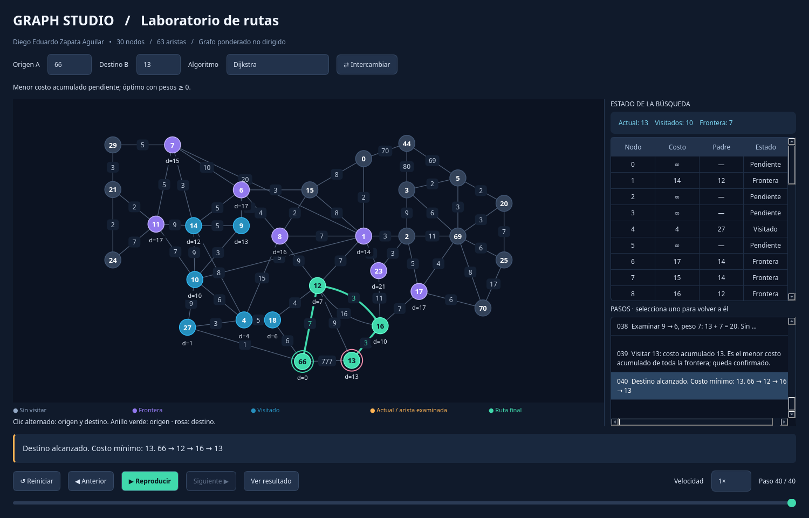

<div align="center">

# Graph Search Algorithms · PyLab

Explora un grafo. Sigue cada decisión. Compara las rutas.

[](#ejecutar)
[](#algoritmos)
[](#pruebas)

**Python · igraph · PyQt6**

</div>

Laboratorio visual para aprender búsquedas en grafos ponderados. Selecciona origen y destino, reproduce la exploración y retrocede para ver cómo cambian las distancias y decisiones. Los cinco algoritmos están implementados manualmente en Python; igraph representa el grafo y PyQt6 dibuja la interfaz.

<p align="center">
  
</p>

<div align="center">

**30 nodos · 63 aristas · 5 algoritmos**<br>
Diego Eduardo Zapata Aguilar

</div>

## Ejecutar

Requiere **Python 3.10 o superior** y un entorno de escritorio.

```bash
git clone git@github.com:ZapataFrame/graph-search-algorithms-pylab.git
cd graph-search-algorithms-pylab
python3 -m venv .venv
source .venv/bin/activate
python -m pip install -r requirements.txt
python main.py
```

En Windows, activa el entorno con `.venv\Scripts\activate`. La instalación inicial requiere Internet; la aplicación funciona localmente.

Elige **Origen A**, **Destino B** y un algoritmo. Usa **Reproducir / Pausar**, **Anterior / Siguiente**, la velocidad o el historial para recorrer los pasos. También puedes seleccionar los nodos con clics alternados sobre el grafo.

## Algoritmos

| Algoritmo | Cómo explora | Qué garantiza |
| :--- | :--- | :--- |
| **Dijkstra** | El menor costo acumulado de toda la frontera | Menor peso, con pesos no negativos |
| **BFS** | Por niveles, con una cola | Menor número de aristas |
| **DFS** | En profundidad, con una pila | Una ruta, sin garantía de mínimo |
| **Fuerza bruta** | Todos los caminos sin repetir nodos | Menor peso al completar la enumeración |
| **Voraz local** | La arista más barata del nodo actual | Puede costar más o quedarse bloqueado |

Dijkstra también es voraz: su elección usa el **costo acumulado**, mientras que el voraz local usa el **peso de una sola arista**. En este grafo, de **66 a 13**, Dijkstra obtiene costo **13** y el voraz local obtiene **19**.

> [!IMPORTANT]
> La fuerza bruta tiene un límite ajustable de **10000 pasos** por defecto. Si lo alcanza, la ruta es **provisional** y no garantiza el mínimo. Se puede pausar y avanzar paso a paso, o usar **Calcular resultado** para procesar por lotes.

## Pruebas

Con el entorno activado:

```bash
python -m unittest -v test_algorithms
```

**11 pruebas**: Dijkstra en los 900 pares de nodos, rutas de BFS y DFS, enumeración exhaustiva en grafos pequeños, aristas paralelas, casos donde el voraz falla y cortes explícitos por límite. Incluyen el caso donde Dijkstra descubre primero costo 777 y después confirma costo mínimo 13.

<details>
<summary><strong>El grafo, los colores y el código</strong></summary>

### El grafo

Transcripción manual de la [imagen original](assets/grafo-original.png). Es un **multigrafo no dirigido**: los cruces no crean nodos y se conservan las dos aristas entre 12 y 16, de pesos **3 y 16**, así como el peso **777** entre 66 y 13. Las coordenadas reproducen la composición de la imagen; no son una heurística del costo al destino.

Las conexiones centrales son `7–6 = 10`, `7–1 = 20`, `6–15 = 3`, `10–1 = 5` y `14–4 = 8`. Se pueden revisar o corregir en `graph_data.py`.

### Leer la animación

**Violeta:** frontera o rama actual. **Azul:** visitado. **Naranja:** nodo actual y arista examinada. **Verde:** ruta encontrada; si hay un corte por límite, mejor ruta provisional. Los anillos verde y rosa indican origen y destino, y `d=` muestra el costo acumulado.

Dijkstra termina cuando selecciona el destino para visitarlo, no cuando lo descubre por primera vez. Las distancias de otros nodos pueden quedar sin confirmar. En fuerza bruta, costos y padres pertenecen a la rama mostrada; un nodo visto puede volver a explorarse en otra rama. El `+` del total indica que faltan pasos por generar. Reiniciar fuerza bruta comienza la enumeración de nuevo.

### Archivos

| Archivo | Responsabilidad |
| :--- | :--- |
| [`main.py`](main.py) | Interfaz, dibujo y controles de animación |
| [`algorithms.py`](algorithms.py) | Cinco algoritmos e instantáneas independientes |
| [`graph_data.py`](graph_data.py) | Nodos, pesos, posiciones y representación igraph |
| [`test_algorithms.py`](test_algorithms.py) | Pruebas de rutas y casos límite |

No se invocan funciones de búsqueda ni caminos mínimos de igraph. `heapq` organiza la cola de prioridad y `deque` la cola FIFO. La fuerza bruta distingue las aristas paralelas, evita ciclos y continúa después del primer camino completo; el voraz local no retrocede. `brute_force(model, origen, destino, max_steps=None)` permite enumerar sin límite como generador; `search` usa un límite predeterminado de 10000 para ese algoritmo.

Para capturar la interfaz sin pantalla en Linux:

```bash
QT_QPA_PLATFORM=offscreen QT_QPA_PLATFORMTHEME= python main.py --screenshot assets/interfaz.png
```

Si Qt no puede cargar `xcb`, instala la biblioteca de escritorio indicada en el error; en Debian/Ubuntu puede faltar `libxcb-cursor0`.

Referencias: [python-igraph](https://python.igraph.org/en/latest/analysis.html) · [Princeton: Shortest Paths](https://algs4.cs.princeton.edu/44sp/).

</details>
